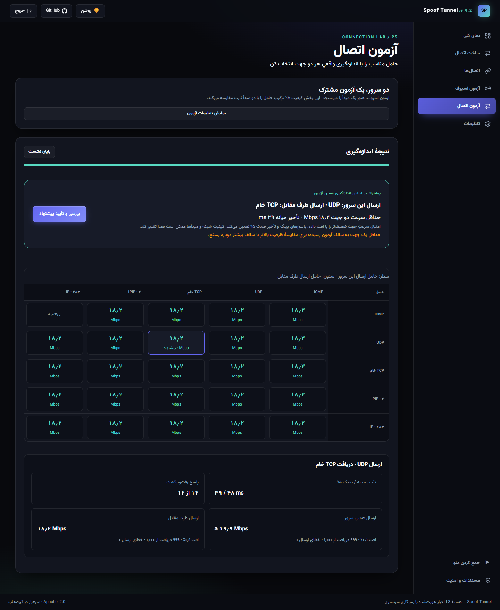

# Carrier-pair connection testing / آزمون ترکیب حامل‌ها

*UI demonstration with simulated results, not a VPS speed claim. نمونهٔ رابط با دادهٔ نمایشی؛ ادعای سرعت سرور نیست.*

## فارسی

از v0.4.2 بخش **آزمون اتصال**، ۲۵ ترکیب مرتبِ حامل ارسال دو سرور را اندازه می‌گیرد: ICMP، UDP، TCP خام، IPIP (شمارهٔ ۴) و پروتکل آزمایشی ۲۵۳. برای مثال ارسال ایران با ICMP و ارسال خارج با TCP، یک گزینهٔ متفاوت از حالت عکس آن است. نوع حامل بیرونی، نوع ترافیک داخل TUN را محدود نمی‌کند.

۱. هر دو پنل و موتور را به‌روز کن. در پنل طرف مقابل، نقش «طرف مقابل» را انتخاب کن. آی‌پی واقعی دو سرور و **یک مبدأ جعلی آزموده‌شده برای ارسال هر سمت** را وارد کن. برای تغییر اتصال موجود، نیمهٔ `remote` همان اتصال را انتخاب کن؛ شناسه/پورت‌ها باید با اتصال فعلی برابر باشند.

۲. اگر می‌خواهی تأیید نهایی بتواند اتصال را در این سرور هم بسازد یا تغییر دهد، اجازهٔ همان عملیات را تیک بزن. سپس کد موقت بساز. کد ۲۰ دقیقه اعتبار دارد؛ کلید موقت آزمون است، نه رمز پنل. آن را فقط در پنل سرور خودت وارد کن. با پایان نشست، سوکت‌های آزمون بسته می‌شوند.

۳. در سرور کنترل‌کننده، معمولاً ایران، نقش کنترل را انتخاب کن. برای جایگزینی اتصال موجود، نیمهٔ `local` همان اتصال را انتخاب کن؛ در حالت ساخت جدید، نام و یک زیرشبکهٔ /30 آزاد تعیین کن. کد طرف مقابل و سقف سرعت/مدت را وارد و آزمون را شروع کن. مبدأها در طول مقایسه ثابت‌اند؛ این بخش اسکن کل استخر نیست.

۴. جدول هر ۲۵ ترکیب را نشان می‌دهد. برای ترکیب پاسخ‌گو، ۱۲ نمونهٔ رفت‌وبرگشت، تأخیر میانه و صدک ۹۵، تعداد دریافت، افت و سرعت دریافت‌شدهٔ هر جهت جدا ثبت می‌شود. برای توصیه حداقل ۸ پاسخ رفت‌وبرگشت و دریافت داده در هر دو جهت لازم است. می‌توانی جزئیات هر خانه را ببینی و پیشنهاد یا یک ترکیب موفق دیگر را انتخاب کنی.

۵. «بررسی و تأیید» ابتدا پیش‌نمایش مشخصی می‌دهد و تداخل تنظیمات هر دو سمت را بررسی می‌کند. هنوز اتصال فعلی تغییر نکرده است. فقط با «تأیید و راه‌اندازی دو سرور» اتصال انتخاب‌شده متوقف و با حامل جدید اجرا می‌شود، یا دو نیمهٔ اتصال جدید ساخته می‌شوند. در جایگزینی، شناسه، کلید، شبکه و رابط TUN، گروه‌های استخر و قوانین فوروارد حفظ می‌شوند. انتخاب دو اتصال نامرتبط یا تغییر تنظیمات پس از پیش‌نمایش پذیرفته نمی‌شود. پیش‌نمایش حدود چهار دقیقه اعتبار دارد.

سنجش سرعت با نرخ پایهٔ ۱ تا ۶۰ مگابیت و پنجرهٔ ۲ تا ۸ ثانیه برای هر جهت انجام می‌شود. مقدار پیش‌فرض ۲۰ مگابیت و ۳ ثانیه، برای کل ماتریس تا حدود ۳۷۵ مگابایت داده به‌علاوهٔ سربار مصرف می‌کند. **سقف انتخابی وجود ندارد: اگر جهتی به نرخ پایه برسد، همان ترکیب با دوبرابر کردن نرخ دوباره سنجیده می‌شود تا جایی که لینک اشباع شود** — وقتی هیچ جهتی به نرخ نرسد، یا دوبرابر کردن نرخ حداکثر ۵٪ به سرعت تحویلی اضافه کند، نردبان می‌ایستد؛ فقط ترکیب‌های موفق دوباره سنجیده می‌شوند و نتیجهٔ نهایی، پلکانی با بیشترین سرعت جهت ضعیف‌تر است. حداکثر اندازه‌گیری ۵۰۰ مگابیت بر ثانیه، حد فرستندهٔ آزمون است، نه یک تنظیم؛ جهتی که هنوز هم در ۵۰۰ مگابیت به سقف برسد، کف ظرفیت را گزارش می‌کند، نه ماکسیمم. آزمون از پهنای باند و CPU استفاده می‌کند و می‌تواند با بار جاری رقابت کند؛ TUN یا مسیریابی اتصال موجود را حین اندازه‌گیری تغییر نمی‌دهد.

معیار پیشنهاد، سرعت جهت ضعیف‌تر با جریمهٔ افت داده/پینگ و تأخیر صدک ۹۵ است. این پیشنهاد مربوط به مبدأها، پورت‌ها و شرایط همان زمان است؛ رتبه‌های نزدیک، مخصوصاً وقتی سقف سرعت پر شده، اثبات برتری قطعی نیستند. TCP خام همان حامل بدون handshake موتور است، نه اتصال TCP معمولی یا گزینهٔ TCP SYN در آزمون اسپوف. ساعت دو سرور باید درست باشد.

اگر اتصال جدید پاسخ احرازشده ندهد، تنظیمات قبلی بازیابی می‌شوند. سمت مقابل برای تغییر تأییدنشده، مهلت ۹۰ ثانیه‌ای دارد و با قطع هماهنگی به تنظیم قبلی برمی‌گردد. یک ژورنال خصوصی SQLite پیش از توقف ثبت می‌شود؛ پس از crash پنل، بازیابی پیش از شروع خودکار اتصال‌ها انجام می‌شود. خطای بازیابی نمایش داده می‌شود و ویرایش تازهٔ کاربر بازنویسی نمی‌شود. قطعی کامل یا خرابی یک میزبان، تأیید هم‌زمان دو ماشین را تضمین‌پذیر نمی‌کند؛ در صورت خطا وضعیت هر دو پنل را بررسی کن.

هنگام اعمال، مبدأ اثبات‌شدهٔ آزمون در هر دو سمت به‌عنوان بذر یک‌بارمصرف در موتور قرار می‌گیرد تا تونل جدید برای تأیید استخر از صفر شروع نکند؛ این بذر فقط وقتی معتبر است که مبدأ و مبدأ طرف مقابل در پیکربندی فعلی باشند و حامل‌ها با ترکیب سنجیده‌شده برابر باشند، و پس از دو دقیقه منقضی می‌شود. مهلت انتظار همتا با اندازهٔ مانیفست همتا مقیاس می‌شود (برای استخر ۱۲۲ هزارتایی با ۲۵ پروب در ثانیه حدود ۷ دقیقه، برای استخرهای کوچک ۱۰۰ ثانیه، حداکثر ۱۵ دقیقه) و در این مدت مهلت اعمال تمدید می‌شود؛ اگر همتا تأیید نشود، خطا دلیل را با وضعیت استخر هر دو سمت گزارش می‌دهد.

اگر اتصال مقصد انتخاب نشده باشد، اعمال اتصالِ هم‌سان را خودش پیدا می‌کند: اتصالی که آی‌پی‌های واقعی دو سرور و زیرشبکهٔ TUN آن با آزمون برابر باشد، جایگزین می‌شود؛ فقط وقتی چنین اتصالی نباشد، اتصال جدید ساخته می‌شود. اگر چند اتصال هم‌سان پیدا شود، اعمال رد می‌شود و باید اتصال مقصد دستی انتخاب شود. خطاهای پیش‌نمایش و اعمال با دلیل فارسی در صفحهٔ آزمون و در کنسول لاگ‌ها ثبت می‌شوند.

## English

**Connection test** compares all 25 ordered transmit-carrier pairs using the production raw packet wrappers and directional AES-GCM codec. It requires two updated Linux panels, raw-socket privileges, correctly synchronized clocks, and one tested spoof source per direction. It works without an existing TUN. A receiver-generated, 256-bit, 20-minute code scopes the session to the specified endpoints and sources. Panel credentials are never transferred. The optional apply capability is granted on the receiver before code generation.

The controller measures 12 authenticated round trips per responsive pair, requiring at least 8 replies, followed by separate paced upload and download windows. Each window uses 1,100-byte random application payloads, unique sequences, authenticated receipt reports and a bounded reordering grace period. Delivered goodput counts unique received bytes divided by the sender's monotonic measurement interval. Failed writes, lost payloads, missing reports and duplicates cannot inflate it. One-way clocks are not subtracted. A failed direction prevents a successful result.

Rate is bounded to 1–60 Mbps for the base round and each direction to 2–8 seconds. Default 20 Mbps × 3 seconds × 25 pairs × 2 directions is about 375 MB of application test data, plus wire overhead. At 95% of the offered rate, results are labelled capped. **There is no user-chosen maximum: a capped cell climbs a doubling ladder (20 → 40 → 80 → 160 → 320 → 500 Mbps) until the link saturates** — a round neither direction caps, or doubling the offer buys at most 5% more delivered goodput — and the reported result is the rung with the highest weaker-direction goodput. The 500 Mbps ceiling is the measurement limit of the sender, not a setting; a direction still capped there reports a lower bound, not capacity. This is a short comparative benchmark, not an exhaustive capacity proof. All cells share the same fixed source pair, carrier ports and payload size. Protocols 4/253 have no ports; ICMP uses the configured Echo identifier. Raw TCP uses the production PSH/ACK wrapper, not the spoof tester's SYN probes.

Recommendation score is `min(upload_Mbps, download_Mbps) × (1 − max(payload_loss, ping_loss)/100)² / (1 + p95_ms/200)`. It prefers balanced delivery and penalizes non-response and latency. Rates close to the cap or each other warrant a higher-cap/longer repeat rather than certainty about a permanent winner. Other pool sources or later network conditions may perform differently.

Measurement opens only tagged raw sockets: no TUN, route, firewall rule or existing process changes. A small `SBF1` tag demultiplexes before authenticated decoding; it is not authentication. Production receivers ignore these frames. Bulk workers, receipt bitsets, control queues and replay state are bounded. Control datagrams are limited to 1,100 plaintext bytes; apply proposals carry compact fixed metadata, never pool inventories. Tests stop on cancellation/expiry and socket errors.

Application is a separate explicit action after a cross-server validation preview. Existing links must be complementary local/remote records with matching key and subnet. Actual carrier ports must match the tested ports. Replacement retains IDs, key, TUN interface/subnet, pool configuration and forwards. New pairs share a fresh key and complementary settings. When no target connection was picked, apply adopts the matching live pair instead of failing on its own subnet: a tunnel with the same real endpoints and TUN subnet is replaced; a new pair is created only when no such pair exists. Several identical pairs refuse with a clear error instead of guessing. Preview and apply failures are recorded with their reason in the Logs console and explained in Persian on the test page. Validation occurs before stopping; revisions are checked again at commit. Both engines must report an authenticated peer after startup. On apply, the benchmark-proven source pair is seeded into each engine as a one-shot bootstrap so the new tunnel does not verify its pool from scratch; the seed is honored only while fresh, with matching carriers, and when both addresses are members of the current configuration, and it expires after two minutes. The peer wait scales with the peer manifest (about 7 minutes for a 122k-source pool at 25 probes/second, 100 seconds for small pools, at most 15 minutes) and the apply lease is renewed while waiting; on timeout the error reports each side's pool readiness and how long it waited. Failures trigger compensating rollback; the receiver has a renewable 90-second unfinalized lease. A private SQLite journal commits atomically with each candidate record and is recovered before panel auto-start after a crash. Newer user edits are preserved. Two-host commit under a complete partition cannot provide an unconditional atomic guarantee; unconfirmed recovery is reported explicitly.

## Validation

`internal/benchmark`: all 25 real raw/AEAD combinations, authenticated replies, both goodput directions, deliberate successful-write-but-dropped data, duplicates, capability validation and unmeasured-apply rejection. `panel/backend/internal/api`: JWT/API orchestration, pre-approval non-mutation, complementary creation, missing-core rollback, crash recovery and newer-edit protection. `scripts/integration_benchmark.py`: two real panels in isolated namespaces; all 25 measurements alongside an existing live TUN; explicit asymmetric replacement; preserved IDs/keys/TUNs/forwards; real TCP/UDP/ICMP and forwarded service traffic afterward. Browser tests cover preview/approval separation, failed cells, receiver permission, rate ceilings, mobile/RTL and desktop themes.

| Before | After | Why |
| --- | --- | --- |
| Manual carrier guessing | A fixed 5 × 5 comparison matrix with per-cell detail | Comparable evidence for ordered directions |
| A result could be mistaken for installation | Separate preview and explicit two-server apply | Keep live connections intact during measurement |
| Large table could widen a narrow screen | Bounded grid track and independently scrollable matrix | Preserve the mobile page width |
| Native progress colour/width | Full-width progress using shared theme tokens | Consistent readable feedback |

## v0.4.3: current source presets

Existing-connection forms now read bounded presets from the selected record and its effective source pools, rather than the original single-IP fallback. With automatic peer sync, the authenticated engine manifest is used without requiring a prior visit to the pools tab or changing stored configuration. A verified selected local source is suggested when available; otherwise a configured candidate is suggested without a health claim. Peer membership is not a quality guarantee. Manual allowed choices remain fixed for all 25 cells. Field-specific errors distinguish local/peer real addresses and local/peer spoof membership.

در v0.4.3، پس از انتخاب اتصال موجود، مشخصات از همان اتصال و استخر فعال دریافت می‌شوند. اگر مبدأ اولیه از استخر حذف شده باشد، فرم آن را پیشنهاد نمی‌کند. فهرست مجاز یادگرفته‌شدهٔ موتور هم برای تطبیق طرف مقابل لحاظ می‌شود. برای اصلاح فرم قبلی، صفحه را تازه کن و اتصال را دوباره انتخاب کن؛ سپس کد تازه بساز. مبدأ پیشنهادی را می‌توان با یک عضو مجاز دیگر عوض کرد؛ آزمون همچنان مبدأ ثابت دارد.

| Before | After | Why |
| --- | --- | --- |
| Prefill from removed single-IP fallbacks | Read selected connection and effective pool presets | The form should generate values accepted by validation |
| One generic English mismatch | Field-specific Persian errors | Identify the address or membership to correct |
| Slow selection could replace a newer choice | Abort and generation-check preset reads | Keep form values synchronized with the selected record |
